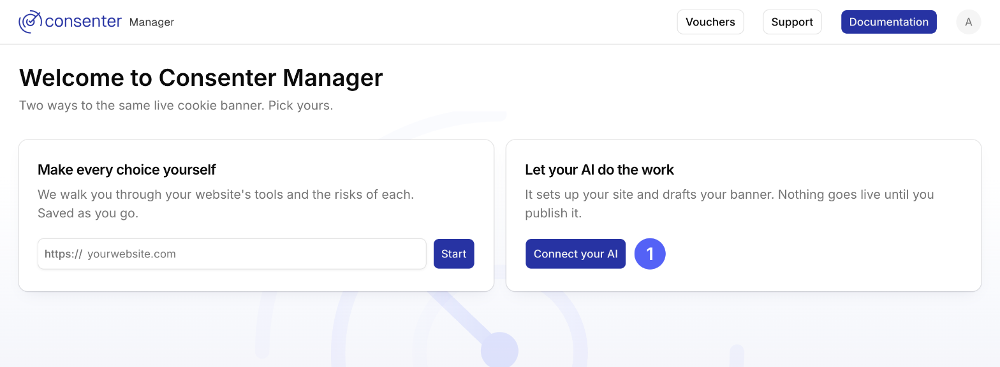
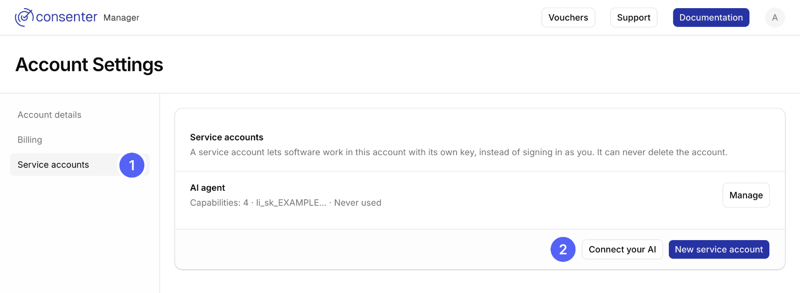

<ConnectAiHero />

## Get your key

<Tabs items={["New account", "Already have a site"]}>
  <Tab value="New account">
    

    Press **Connect your AI**.

  </Tab>
  <Tab value="Already have a site">
    

    Open **Service accounts** in your account, then press **Connect your AI**.

  </Tab>
</Tabs>

Then choose **Create an access key instead**.

## Add it to your AI

Your AI's own guide has the current steps. You'll need this address: `https://manager.consenter.eu/api/mcp`

Your key goes in your AI's connection settings as an `Authorization` header, never in a chat message.

<GuideLinks>

- [ChatGPT](https://help.openai.com/en/articles/12584461-connecting-custom-mcp-servers-in-chatgpt)
- [Claude](https://claude.com/docs/connectors/custom/add-unlisted)
- [Perplexity](https://www.perplexity.ai/help-center/en/articles/13915507-adding-custom-remote-connectors)
- [Claude Code](https://code.claude.com/docs/en/mcp)
- [Codex](https://developers.openai.com/codex/mcp)
- [Cursor](https://cursor.com/docs/mcp)

</GuideLinks>

## Skills

Ready-made instructions your AI can follow. Install one, or send your AI its link.

<GuideLinks>

- [Set up your cookie banner](/skills/consenter-banner/SKILL.md)

</GuideLinks>

## If something goes wrong

<HelpCards>
  <HelpCard title="It isn't allowed, or a tool is missing">Press **Connect your AI** for a new key, then reconnect.</HelpCard>
  <HelpCard title="To stop your AI">Open Service accounts, press **Manage** and disable it.</HelpCard>
</HelpCards>
